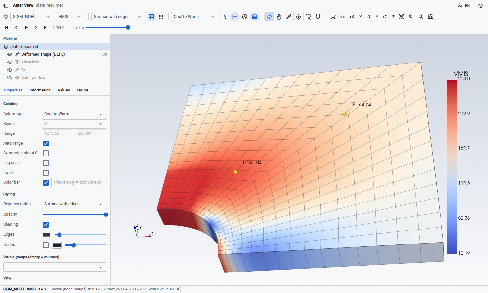
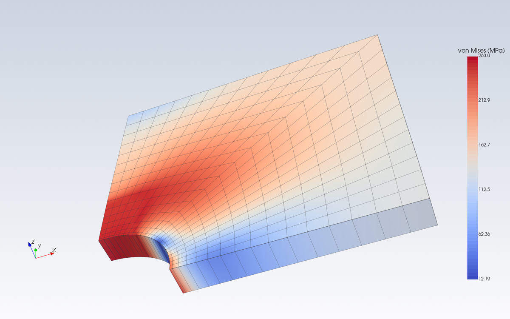
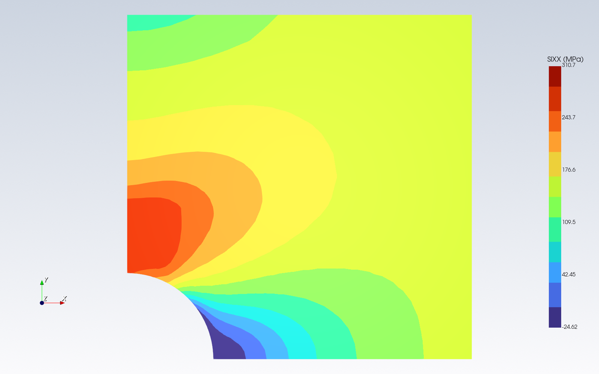
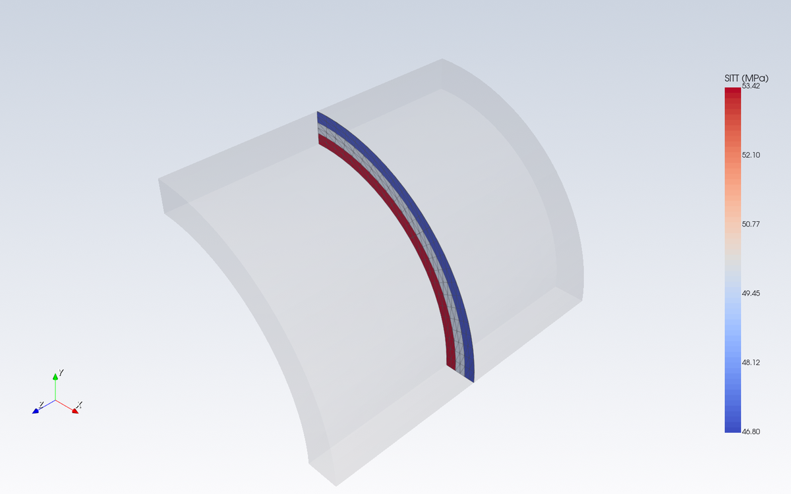
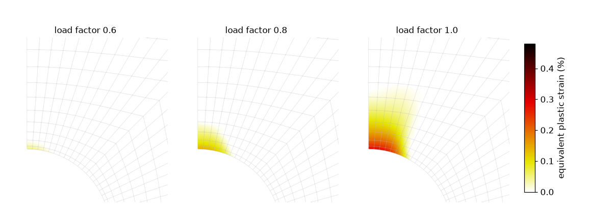
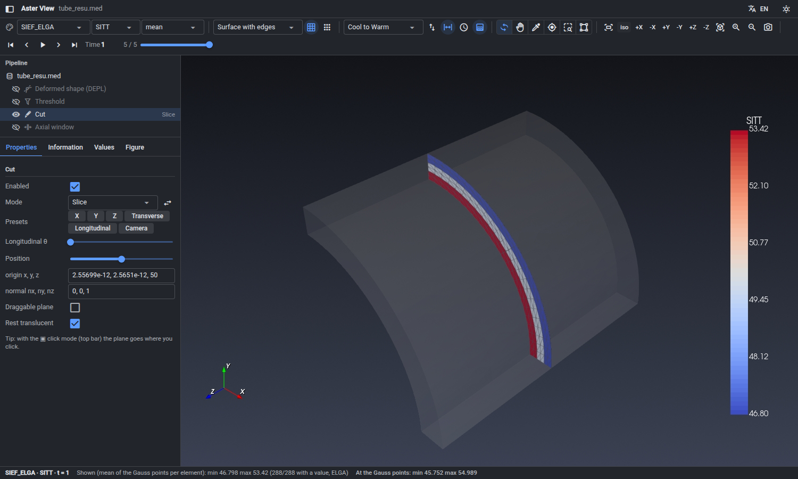
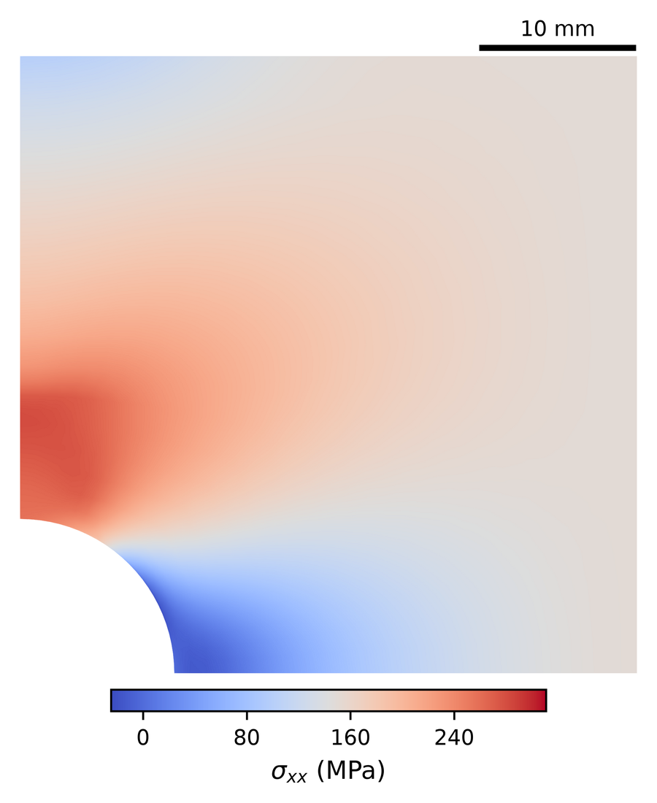
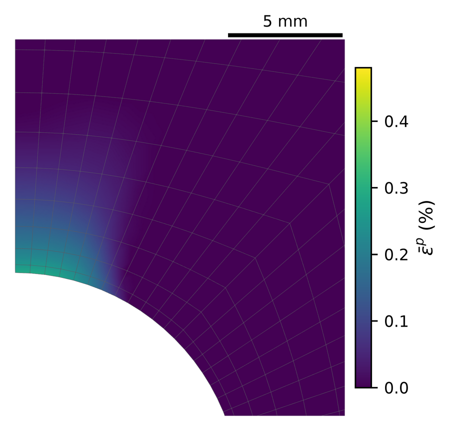
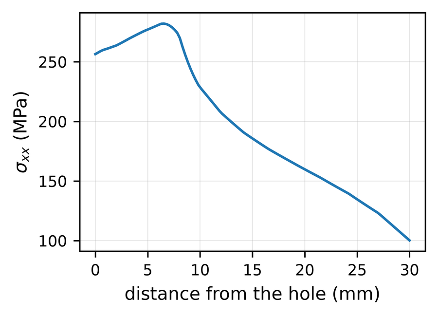
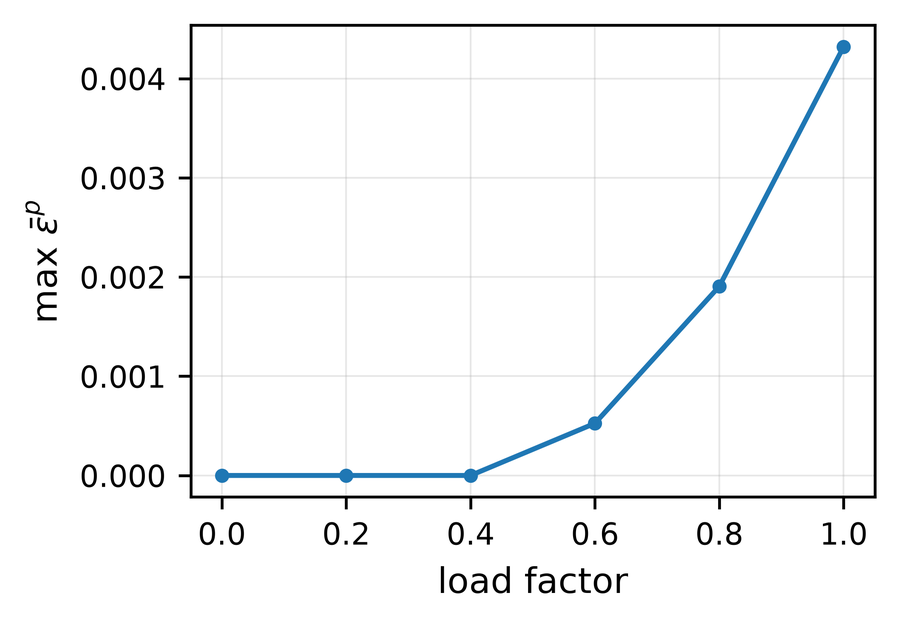

# Aster View

[](https://github.com/tin7/aster-view/actions/workflows/tests.yml)
[](LICENSE)

[English](README.md) · **Español** · [Français](README.fr.md)

Visor interactivo y servidor [MCP](https://modelcontextprotocol.io) de solo lectura para **resultados MED de code_aster** (`.med`, `.rmed`).

- **Visor**: estilo ParaView, en el navegador o en una pestaña de VS Code. Permite recorrer campos e instantes, ver la deformada, cortar con cualquier plano, leer valores con un clic, ver los puntos de Gauss y exportar figuras para revistas.
- **Extensión de VS Code**: clic derecho sobre un `.med` → *Abrir en Aster View*.
- **Servidor MCP** (`aster-med`): permite que un asistente de IA (Claude Code, Claude Desktop o cualquier cliente MCP) lea números, saque imágenes, arme figuras y te abra el visor. Nunca lanza corridas ni modifica tus archivos.
- **Tres idiomas**: English, Español, Français. Se elige en el visor y queda recordado.



El visor, las imágenes y el servidor MCP usan el mismo lector y la misma escena VTK: lo que informa el asistente es lo que ves.

## Galería

| | |
|:---:|:---:|
|  |  |
| tensión de von Mises sobre la deformada (×30), con los elementos | σxx en 12 bandas de color, vista de arriba |
|  |  |
| tensión circunferencial σθ (componente cilíndrica) en una sección transversal, el resto translúcido | deformación plástica equivalente en tres instantes |

Las figuras para revistas están en [su propia sección](#figuras-para-revistas). Todas las imágenes salen de los dos ejemplos de [`examples/`](examples) y se regeneran con `python docs/make_images.py`.

## Contenido

- [Galería](#galería)
- [Instalación](#instalación)
- [Primeros pasos](#primeros-pasos)
- [El visor](#el-visor)
- [Figuras para revistas](#figuras-para-revistas)
- [Componentes derivadas](#componentes-derivadas)
- [Servidor MCP](#servidor-mcp)
- [Salidas y configuración](#salidas-y-configuración)
- [Cómo está verificado](#cómo-está-verificado)
- [Limitaciones](#limitaciones)
- [Desarrollo](#desarrollo)
- [Licencia y agradecimientos](#licencia-y-agradecimientos)

## Instalación

Hace falta **Python 3.10 o posterior**. Está probado en Linux (Ubuntu, Python 3.11 y 3.12, VTK 9.7, trame 4).
**No** hace falta code_aster: los MED se leen directamente con `h5py`.

### 1. El paquete de Python

En un entorno virtual (recomendado):

```bash
python3 -m venv ~/venvs/aster-view
source ~/venvs/aster-view/bin/activate
pip install git+https://github.com/tin7/aster-view
```

Con conda: `conda create -n aster-view python=3.11 -y && conda activate aster-view`, y después la misma línea de `pip install`.

Se instalan dos comandos:

| comando | qué hace |
|---|---|
| `aster-view archivo.med` | abre el visor en el navegador |
| `aster-mcp` | el servidor MCP (lo arranca tu cliente MCP, no vos) |

Las dependencias se instalan solas: `vtk`, `trame` (+ `trame-vtk`, `trame-vuetify`), `h5py`, `numpy`, `matplotlib` y `mcp`.
El dibujo se hace fuera de pantalla en tu máquina y al navegador solo llegan imágenes. No hace falta GPU ni WebGL.

### 2. La extensión de VS Code (opcional)

1. Bajá `aster-view-<versión>.vsix` de la [última versión publicada](https://github.com/tin7/aster-view/releases).
2. En VS Code: paleta de comandos (`Ctrl+Shift+P`) → **Extensions: Install from VSIX…** → elegí el archivo.
3. Recargá la ventana.

La extensión busca el comando `aster-view` en el `PATH`, en `~/.local/bin` y en los entornos conda (`anaconda3`, `miniconda3`, `miniforge3`…). Si está en otro lado, por ejemplo en un venv, poné su ruta completa en el ajuste **Aster View: Executable** (p. ej. `/home/yo/venvs/aster-view/bin/aster-view`).

### 3. El servidor MCP (opcional)

El cliente MCP arranca el servidor; vos solo registrás el comando. Usá la ruta completa de `aster-mcp`, que te da `which aster-mcp` dentro del entorno.

**Claude Code:**

```bash
claude mcp add --scope user aster-med -- /home/yo/venvs/aster-view/bin/aster-mcp
```

**Claude Desktop** (`claude_desktop_config.json`):

```json
{
  "mcpServers": {
    "aster-med": { "command": "/home/yo/venvs/aster-view/bin/aster-mcp" }
  }
}
```

Otros clientes MCP: correr `aster-mcp` por stdio.

## Primeros pasos

El repositorio trae dos ejemplos chicos, los dos calculados con code_aster 17.4:

| ejemplo | qué muestra |
|---|---|
| [`examples/thick_tube`](examples/thick_tube) | un cuarto de tubo de pared gruesa con presión interna (HEXA20, 2,6 MB). Tiene solución exacta (Lamé), así que sirve además de prueba. |
| [`examples/plate_hole`](examples/plate_hole) | un cuarto de placa con agujero traccionada hasta plastificar (HEXA20, elastoplástico, 3,3 MB): concentración de tensiones, una zona plástica que crece en el tiempo y variables internas en los puntos de Gauss. |

```bash
git clone https://github.com/tin7/aster-view && cd aster-view
aster-view examples/plate_hole/plate_resu.med --field SIGM_NOEU --comp VMIS
```

Se abre el navegador con la tensión de von Mises. Para probar:

- el botón **⊞** de la barra de herramientas muestra los elementos;
- en el *Pipeline*, el ojo de *Deformada* la prende; con un clic en el nombre se cambia la escala;
- el ojo de *Corte* prende un corte; con un clic en *Corte* se elige un atajo (X, Y, Z, transversal…);
- el gotero lee valores con un clic; quedan en la pestaña *Valores*;
- el idioma y el tema oscuro están arriba a la derecha.

Desde VS Code: clic derecho sobre `plate_resu.med` en el explorador → **Abrir en Aster View (resultados)**.

Con un cliente MCP, pedí algo como *"abrime examples/plate_hole/plate_resu.med en el visor"* o *"σθ máxima en los puntos de Gauss de examples/thick_tube/tube_resu.med"*.

`aster-view --help` muestra las opciones: `--field`, `--comp`, `--mesh`, `--port`, `--no-browser`, `--lang es|en|fr`, `--timeout`. Siguen valiendo los nombres en español de la v0.2: `--campo`, `--puerto`, `--sin-navegador`.

## El visor



La disposición sigue a ParaView:

- **Barra de herramientas** (arriba):
  - colorear por campo y componente y, en campos en puntos de Gauss, el valor por elemento (promedio, mínimo, máximo o máx. |valor| de sus puntos de Gauss);
  - representación, aristas de los elementos y nodos;
  - mapa de colores, invertir, reescalar a lo visible o a todos los instantes, barra de colores;
  - modo del clic, cámara y controles de tiempo.
- **Pipeline** (izquierda): el archivo y cuatro filtros, cada uno con un ojo para prenderlo o apagarlo:
  - *deformada* (DEPL × escala);
  - *umbral* por valor;
  - *corte* (recortar, sección o celdas enteras);
  - *ventana axial*.

  Un clic en un ítem muestra sus propiedades.
- **Pestañas** debajo del pipeline:
  - *Propiedades* del ítem elegido. Para el archivo: coloreado (mapa, bandas, rango, escala log, rango simétrico, barra de colores), estilo (representación, opacidad, sombreado, color y tamaño de aristas y nodos), grupos visibles, vista (fondo, textos, triedro), vistas guardadas y eje cilíndrico.
  - *Información*: la malla (nodos, celdas por tipo, límites) y los campos (soporte, componentes, instantes).
  - *Valores*: los puntos leídos con el gotero (valor, nodo más cercano, coordenadas). Se actualizan al cambiar de instante o de componente.
  - *Figura*: figuras para revistas, ver [más abajo](#figuras-para-revistas).
- **Barra de estado** (abajo): campo, componente e instante, el min/max de lo pintado y, en campos en puntos de Gauss, el min/max en los puntos de Gauss. Se muestran los dos porque el promedio por elemento esconde los picos.
- **Arriba a la derecha**: idioma y tema claro/oscuro. Los dos quedan recordados.

**Mouse.**
- Arrastrar rota.
- La rueda hace zoom **hacia el cursor**.
- Shift + arrastrar desplaza.
- Ctrl + arrastrar gira en el plano de la pantalla.
- Arrastrar la **barra de colores** la mueve, y tirar de uno de sus bordes la estira; cerca de arriba o de abajo se pone horizontal. Las ubicaciones rápidas (derecha, izquierda, arriba, abajo) están en *Propiedades → Coloreado*, y la ubicación queda guardada con las vistas y las recetas de figura.

**Modos del clic** (barra de herramientas):
- rotar;
- **mano**: desplaza sin rotar;
- leer valor;
- centrar la vista en un punto;
- **lupa**: arrastrar un recuadro para ampliarlo, como el *Zoom to Box* de ParaView (un clic simple acerca ×2);
- ubicar el plano de corte.

**Corte:**
- recortar, sección o celdas enteras;
- atajos X, Y, Z, transversal, longitudinal (a un ángulo θ) y de frente a la cámara;
- posición a lo largo de la normal, u origen y normal a mano;
- un plano arrastrable en 3D;
- el resto de la pieza translúcido.

El visor escucha solo en `localhost`. Se cierra solo 10 minutos después de cerrar su última pestaña.

**En VS Code** el visor se abre en una pestaña. Formas de abrirlo:
- clic derecho sobre el archivo en el explorador o sobre su pestaña → *Abrir en Aster View (resultados)*;
- **Abrir con… → Aster View (resultados)**; desde ahí se lo puede dejar como editor predeterminado de `*.med`;
- el botón **Aster View** de la barra de estado, con un `.med` abierto;
- el botón con ícono de gráfico en la barra del visor de malla de [VS Code Aster](https://github.com/simvia-tech/vs-code-aster).

Ajustes de la extensión:
- `asterView.executable`;
- `asterView.openIn`: pestaña de `vscode` o `browser` del sistema;
- `asterView.language`: `auto` = el último idioma elegido en el visor; la primera vez, el de VS Code.

**Relación con VS Code Aster.** La extensión [VS Code Aster](https://github.com/simvia-tech/vs-code-aster) de Simvia edita `.comm`/`.export`, lanza estudios y muestra **mallas y grupos**. Aster View la complementa con los **resultados**: campos, instantes, deformada, cortes, puntos de Gauss y figuras. Se pueden tener las dos instaladas.

## Figuras para revistas

El panel *Figura para paper* (o la herramienta MCP `med_figure`) escribe una figura con estilo de revista:

- VTK dibuja solo la geometría: fondo blanco y, por defecto, sin sombreado, así los colores son exactamente los de la barra;
- matplotlib pone la barra y los textos (DejaVu Sans 9/10 pt, 600 dpi);
- la figura se encuadra igual que la vista actual.

| | |
|:---:|:---:|
|  |  |
|  |  |

Las dos de arriba se hacen en la pestaña *Figura* (o con `med_figure`). Las dos de abajo son los gráficos de `med_line` y `med_history`, que usan el mismo estilo y también se guardan en PDF.

Opciones:
- ancho de 1, 1,5 o 2 columnas;
- barra horizontal, vertical o ninguna;
- rótulo con mathtext (`$\sigma_\theta$ (MPa)`) y factor para los valores (p. ej. 1000 para pasar de m a mm);
- escala de longitud (con proyección paralela).

Salida en `<salidas>/<nombre del med>/figuras/`:
- PDF y PNG a 600 dpi;
- una **receta `.json`** con todo el estado y la cámara, para que `med_figure(recipe=...)` regenere la misma figura más adelante;
- la línea `\includegraphics[width=X\linewidth]`. Su ancho deja la letra del mismo tamaño que en las demás figuras de una columna de un artículo de Elsevier a dos columnas (columna = 243 pt).

## Componentes derivadas

Además de las componentes guardadas en el archivo, se calculan:

- `NORM`;
- `DR` / `DT` / `DA`: desplazamiento cilíndrico;
- `SIRR` / `SITT` / `SIAA` / `SIRT` / `SIRA` / `SITA`: tensiones en cilíndricas, y lo mismo para cualquier otro tensor simétrico guardado como `<P>XX…<P>YZ`;
- `VMIS` y `TRACE`.

El eje cilíndrico va a lo largo del lado más largo de la caja. Pasa por el centro común de los nodos cuando forman anillos (tubos enteros, medios o cuartos); si no, por el centro de la caja. Se cambia en el panel *Eje cilíndrico* o con `axis_point` / `axis_dir`. La dirección radial sale de la geometría **sin deformar**.

### Modelos 2D, campos ELNO y varias mallas

- **Modelos 2D** (`D_PLAN`, `C_PLAN`, `AXIS`): la malla se dibuja en el plano xy, de frente y con proyección paralela. Los tensores de tensión traen 4 componentes (SIXX, SIYY, SIZZ, SIXY); con ellas se calculan `VMIS` y `TRACE`. No se ofrecen componentes cilíndricas, porque en un modelo axisimétrico las componentes ya son cilíndricas: SIXX = σr, SIYY = σz, SIZZ = σθ.
- **Campos ELNO** (`SIGM_ELNO`, `VARI_ELNO`…): un valor por nodo de cada elemento. Se pintan como los de puntos de Gauss (un valor por elemento: promedio, mínimo, máximo o máx. |valor| de sus nodos), y las estadísticas y extracciones dan cada valor con su elemento y su nodo.
- **Varias mallas en un archivo** (p. ej. dos `IMPR_RESU` de resultados en mallas distintas): cada campo se lee con su propia malla. El visor muestra un selector de *Malla* en las propiedades del archivo (y acepta `--mesh`). Las herramientas MCP toman el nombre completo del campo, p. ej. `r2d_____DEPL`, o `mesh=` cuando el mismo nombre corto está en más de una malla; `med_info` lista las mallas y sus campos.

## Servidor MCP

| herramienta | qué hace |
|---|---|
| `med_info` | malla, grupos y campos (soporte, componentes, instantes, perfil); detecta archivos truncados |
| `med_steps` | instantes de un campo |
| `med_stats` | min/max con su ubicación, media y percentiles, sobre un grupo o todo el modelo |
| `med_history` | evolución temporal en un grupo, en un nodo o en el punto más cercano a (x, y, z) (tabla + gráfico con estilo de revista, PNG y PDF) |
| `med_line` | perfil a lo largo de un segmento, también sobre una cara del borde como un plano de simetría (CSV + gráfico con estilo de revista, PNG y PDF) |
| `med_extract` | valores crudos con coordenadas sobre un grupo (CSV) |
| `med_render` | imagen PNG con todos los controles del visor (corte con cualquier plano, umbral, fondo…) o desde una vista guardada |
| `med_figure` | figura para revista (PDF/PNG/receta), con parámetros o desde una receta |
| `med_view` | abre el visor interactivo para el usuario |
| `med_to_vtu` | serie `.pvd` + `.vtu` para un ParaView sin lector MED |

Las estadísticas, extracciones e historias usan los puntos de Gauss mismos. Las imágenes pintan un valor por elemento. **Los números que se informan tienen que salir de `med_stats`, `med_extract` o `med_line`, no de los colores.**

Las descripciones de las herramientas están en inglés. Los valores de las opciones también se aceptan con su rótulo en español o francés, p. ej. `clip_mode="slice"`, `"Sección"` o `"Section"`. Con varias mallas en el archivo, las herramientas aceptan `mesh=`.

## Salidas y configuración

Aster View **nunca modifica los `.med`**. Todo lo que escribe va a `<salidas>/<nombre del med>/`: capturas, CSV, figuras, vistas guardadas (`vistas/`) y VTU.

`<salidas>` es, en este orden de prioridad:
1. la variable de entorno `ASTER_VIEW_OUT`;
2. `"output_dir"` en `~/.config/aster-view/config.json`;
3. `~/aster_view_output`.

En el mismo archivo queda el idioma elegido en el visor:

```json
{ "language": "es", "output_dir": "~/resultados/aster_view" }
```

El idioma se decide en este orden: `--lang`, después el último elegido en el visor, después la variable de entorno `ASTER_VIEW_LANG`, después el idioma del sistema y, por último, inglés.

## Cómo está verificado

- **Solución exacta** (`tests/test_reader.py`, corre en CI). Sobre el tubo de ejemplo, contra Lamé:
  - σr en los 7776 puntos de Gauss con error menor que 0,6 % de la presión;
  - σθ, menor que 0,25 %;
  - σz ≈ 0;
  - desplazamiento radial con 4·10⁻⁶ de error relativo;
  - los campos a t = 0,5 son exactamente la mitad de los de t = 1.
- **Contra MEDCoupling 9.15**, con archivos de producción de code_aster 17.4: SIEF_ELGA en HEXA20 idéntico, coordenadas de los puntos de Gauss con diferencia de 2·10⁻¹⁵, y un DEPL con perfil (modelo restringido con `GROUP_MA`) con los mismos NaN y valores idénticos. `tests/ref_medcoupling_docker.py` repite la comparación con tus archivos dentro de la imagen Docker de code_aster.
- **Contra un script de postproceso independiente**: en un modelo HEXA20 de producción, las tensiones en cilíndricas reprodujeron 24 valores promediados calculados con MEDCoupling, con diferencia máxima de 3·10⁻¹⁴ MPa.
- **ELNO, 2D y varias mallas** (`tests/test_formats.py`, archivos chicos de code_aster en `tests/data`):
  - `SIGM_ELNO` promediado en los elementos que rodean cada nodo da exactamente el `SIGM_NOEU` de code_aster, así que cada valor ELNO está en su nodo;
  - von Mises con las 4 componentes de los modelos 2D coincide con el `SIEQ_ELGA` de code_aster (QUAD8 y TRIA6, hasta 1e-13);
  - un tubo axisimétrico coincide con Lamé con error menor que 0,3 % de la presión;
  - un archivo con una malla 3D y otra 2D se lee campo por campo con la malla correcta.
- **Visor y servidor MCP**: `pytest` cubre el dibujo fuera de pantalla, el valor por elemento, la lectura con clic, las vistas guardadas, los tres idiomas y todas las herramientas MCP de punta a punta por stdio.

## Limitaciones

- Los colores de un campo en puntos de Gauss son un valor por elemento (promedio, mínimo, máximo o máx. |valor|), no una extrapolación a los nodos.
- Todavía no hay isolíneas (Contour), flechas de vectores, ejes con coordenadas ni varias vistas lado a lado.
- En pirámides (PY5/P13) los puntos de Gauss se ubican en el centroide.
- Probado solo en Linux. En Windows y macOS debería andar, porque todas las dependencias traen paquetes binarios, pero no se probó.
- Si la vista 3D queda negra (pasa con Xvfb, una pantalla X virtual), arrancá el visor con `VTK_DEFAULT_OPENGL_WINDOW=vtkEGLRenderWindow`, o sin `DISPLAY`. Nunca necesita una ventana en pantalla.
- No se probó el zoom con la rueda dentro de la pestaña de VS Code. Si la vista no responde, hacé clic una vez sobre ella para darle foco; los botones ± y la lupa andan siempre.

## Desarrollo

```bash
git clone https://github.com/tin7/aster-view && cd aster-view
pip install -e ".[test]"
pytest                      # todas las pruebas (VTK dibuja fuera de pantalla)
pytest -m "not render"      # solo lector, componentes y traducciones
```

La lista de archivos está en el [README en inglés](README.md#development).

- **Regenerar el ejemplo** necesita Docker y la imagen oficial: `examples/thick_tube/run.sh` (unos 30 s).
- **Armar la extensión**: `cd vscode && npx @vscode/vsce package`.
- **Agregar un idioma**: una columna más en `UI` y `CHOICES` de `aster_view/i18n.py`, y después `package.nls.<idioma>.json` y `l10n/bundle.l10n.<idioma>.json` en `vscode/`.

Los errores y sugerencias van en los [issues](https://github.com/tin7/aster-view/issues). Si un archivo no abre o se ve mal, sumá la salida de `med_info` o el mensaje de error.

## Licencia y agradecimientos

MIT, ver [LICENSE](LICENSE).

- Los mapas de colores salen de los presets de ParaView 5.11 (BSD-3-Clause, Kitware).
- El visor usa [VTK](https://vtk.org) y [trame](https://kitware.github.io/trame/).
- code_aster lo desarrolla EDF. Este proyecto es independiente y no está afiliado a EDF ni a Simvia.
