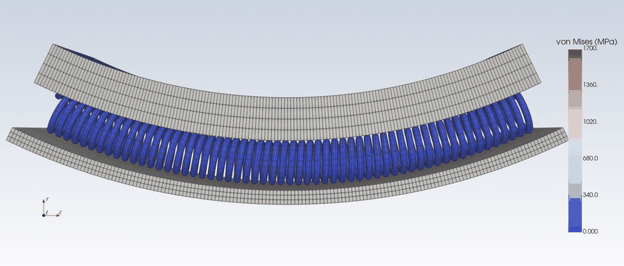
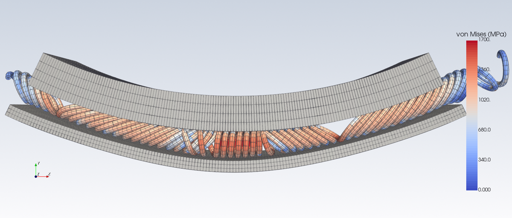

# Aster View

[](https://github.com/tin7/aster-view/actions/workflows/tests.yml)
[](LICENSE)

[English](README.md) · [Español](README.es.md) · **Français**

Visualiseur interactif et serveur [MCP](https://modelcontextprotocol.io) en lecture seule pour les **résultats MED de code_aster** (`.med`, `.rmed`).

- **Visualiseur** : dans l'esprit de ParaView, dans le navigateur ou dans un onglet de VS Code. On y parcourt les champs et les instants, on affiche la déformée, on coupe par n'importe quel plan, on lit des valeurs d'un clic, on regarde les points de Gauss et on exporte des figures pour revues.
- **Extension VS Code** : clic droit sur un `.med` → *Ouvrir dans Aster View*.
- **Serveur MCP** (`aster-med`) : un assistant IA (Claude Code, Claude Desktop ou tout client MCP) peut lire des valeurs, produire des images et des figures et vous ouvrir le visualiseur. Il ne lance jamais de calcul et ne modifie jamais vos fichiers.
- **Trois langues** : English, Español, Français. La langue se choisit dans le visualiseur et elle est mémorisée.


Le visualiseur, les images et le serveur MCP partagent le même lecteur et la même scène VTK : ce que rapporte l'assistant est ce que vous voyez.

## Galerie



*Un ressort (garter spring) écrasé entre deux tubes (contact et plasticité, 52 instants, déformation à l'échelle réelle) : contrainte de von Mises, surface avec arêtes. Le fichier de résultats (1,96 Go) se télécharge depuis la [version v0.4.1](https://github.com/tin7/aster-view/releases/tag/v0.4.1).*

| | |
|:---:|:---:|
|  |  |
| contrainte de von Mises sur la déformée (×30), avec les éléments | σxx en 12 bandes de couleur, vue de dessus |
|  |  |
| contrainte circonférentielle σθ (composante cylindrique) sur une section transversale, le reste en transparence | le ressort à la fin de l'écrasement |

Les figures pour revues ont [leur propre section](#figures-pour-revues). Les images du tube et de la plaque viennent des deux exemples de [`examples/`](examples) et se régénèrent avec `python docs/make_images.py`.

## Sommaire

- [Galerie](#galerie)
- [Installation](#installation)
- [Premiers pas](#premiers-pas)
- [Le visualiseur](#le-visualiseur)
- [Figures pour revues](#figures-pour-revues)
- [Composantes dérivées](#composantes-dérivées)
- [Serveur MCP](#serveur-mcp)
- [Sorties et réglages](#sorties-et-réglages)
- [Vérification](#vérification)
- [Limites](#limites)
- [Développement](#développement)
- [Licence et remerciements](#licence-et-remerciements)

## Installation

Il faut **Python 3.10 ou plus récent**. Testé sous Linux (Ubuntu, Python 3.11 et 3.12, VTK 9.7, trame 4).
code_aster n'est **pas** nécessaire : les fichiers MED sont lus directement avec `h5py`.

### Installation rapide (Ubuntu/Debian)

Une seule commande fait tout :

```bash
wget -qO- https://raw.githubusercontent.com/tin7/aster-view/main/install.sh | sh
```

Elle demande votre mot de passe (`sudo`) pour installer ce qui manque au système : Python avec `venv` et `pip`, et les bibliothèques OpenGL dont VTK a besoin. Ensuite elle fait quatre choses :
- elle crée un environnement virtuel dans `~/venvs/aster-view` ;
- elle installe le paquet (git n'est pas nécessaire) ;
- elle place les commandes `aster-view` et `aster-mcp` dans `~/.local/bin` ;
- si VS Code est présent, elle installe l'extension.

Cela prend quelques minutes, car VTK et trame sont volumineux. Les étapes 1 à 3 ci-dessous font la même chose à la main.

### 1. Le paquet Python

D'abord les paquets du système (Ubuntu/Debian ; un système neuf peut ne pas avoir `pip` ni `git`) :

```bash
sudo apt install python3 python3-venv python3-pip git
```

Ensuite, dans un environnement virtuel (recommandé) :

```bash
python3 -m venv ~/venvs/aster-view
source ~/venvs/aster-view/bin/activate
pip install git+https://github.com/tin7/aster-view
```

Avec conda : `conda create -n aster-view python=3.11 -y && conda activate aster-view`, puis la même ligne `pip install`.

En cas d'échec (Ubuntu/Debian) :
- `ensurepip is not available` à la création de l'environnement : installez le module venv avec `sudo apt install python3-venv` (ou `python3.12-venv`, selon votre Python), supprimez le `~/venvs/aster-view` resté inachevé et recréez-le.
- `Cannot find command 'git'` : installez git avec `sudo apt install git`, ou installez depuis l'archive de la version, sans git : `pip install https://github.com/tin7/aster-view/archive/refs/tags/v0.4.1.zip`.
- `externally-managed-environment` : `pip` a tourné hors de l'environnement ; activez-le d'abord avec `source ~/venvs/aster-view/bin/activate`.

Deux commandes sont installées :

| commande | rôle |
|---|---|
| `aster-view fichier.med` | ouvre le visualiseur dans le navigateur |
| `aster-mcp` | le serveur MCP (lancé par votre client MCP, pas par vous) |

Les dépendances s'installent automatiquement : `vtk`, `trame` (+ `trame-vtk`, `trame-vuetify`), `h5py`, `numpy`, `matplotlib` et `mcp`.
Le rendu se fait hors écran sur votre machine et le navigateur ne reçoit que des images : ni GPU ni WebGL ne sont nécessaires.

### 2. L'extension VS Code (facultative)

1. Téléchargez `aster-view-<version>.vsix` depuis la [dernière version publiée](https://github.com/tin7/aster-view/releases).
2. Dans VS Code : palette de commandes (`Ctrl+Shift+P`) → **Extensions: Install from VSIX…** → choisissez le fichier.
3. Rechargez la fenêtre.

L'extension cherche la commande `aster-view` dans le `PATH`, dans `~/.local/bin`, dans les environnements virtuels de `~/venvs` (aussi `~/.venvs`, `~/.virtualenvs`, `~/venv`) et dans les environnements conda (`anaconda3`, `miniconda3`, `miniforge3`…). Si elle est ailleurs, indiquez son chemin complet dans le réglage **Aster View: Executable** (p. ex. `/home/moi/ailleurs/bin/aster-view`). Inutile de choisir un interpréteur Python dans VS Code : l'extension lance directement la commande `aster-view`.

### 3. Le serveur MCP (facultatif)

Le client MCP démarre le serveur lui-même ; il suffit d'enregistrer la commande. Utilisez le chemin complet de `aster-mcp`, donné par `which aster-mcp` dans l'environnement.

**Claude Code :**

```bash
claude mcp add --scope user aster-med -- /home/moi/venvs/aster-view/bin/aster-mcp
```

**Claude Desktop** (`claude_desktop_config.json`) :

```json
{
  "mcpServers": {
    "aster-med": { "command": "/home/moi/venvs/aster-view/bin/aster-mcp" }
  }
}
```

Autres clients MCP : lancer `aster-mcp` en stdio.

## Premiers pas

Le dépôt contient deux petits exemples, tous deux calculés avec code_aster 17.4 :

| exemple | ce qu'il montre |
|---|---|
| [`examples/thick_tube`](examples/thick_tube) | un quart de tube épais sous pression interne (HEXA20, 2,6 Mo). Sa solution exacte est connue (Lamé), il sert donc aussi de test. |
| [`examples/plate_hole`](examples/plate_hole) | un quart de plaque trouée tirée jusqu'à la plastification (HEXA20, élastoplastique, 3,3 Mo) : concentration de contraintes, une zone plastique qui grandit au cours du temps et des variables internes aux points de Gauss. |

```bash
git clone https://github.com/tin7/aster-view && cd aster-view
aster-view examples/plate_hole/plate_resu.med --field SIGM_NOEU --comp VMIS
```

Le navigateur s'ouvre sur la contrainte de von Mises. À essayer :

- le bouton **⊞** de la barre d'outils affiche les éléments ;
- dans le *Pipeline*, l'œil de *Déformée* l'active ; un clic sur son nom permet de changer l'échelle ;
- l'œil de *Coupe* active une coupe ; un clic sur *Coupe* propose des raccourcis (X, Y, Z, transversal…) ;
- la pipette lit des valeurs d'un clic ; elles sont listées dans l'onglet *Valeurs* ;
- la langue et le thème sombre sont en haut à droite.

Depuis VS Code : clic droit sur `plate_resu.med` dans l'explorateur → **Ouvrir dans Aster View (résultats)**.

Avec un client MCP, demandez par exemple *« ouvre examples/plate_hole/plate_resu.med dans le visualiseur »* ou *« σθ maximale aux points de Gauss de examples/thick_tube/tube_resu.med »*.

`aster-view --help` liste les options : `--field`, `--comp`, `--mesh`, `--port`, `--no-browser`, `--lang es|en|fr`, `--timeout`.

## Le visualiseur


La disposition suit ParaView :

- **Barre d'outils** (en haut) :
  - colorer par champ et composante et, pour les champs aux points de Gauss, la valeur par élément (moyenne, min, max ou max |valeur| de ses points de Gauss) ;
  - représentation, arêtes des éléments et nœuds ;
  - palette, inverser, recalibrer sur les données visibles ou sur tous les instants, barre de couleurs ;
  - mode du clic, caméra et contrôle du temps.
- **Pipeline** (à gauche) : le fichier et quatre filtres, chacun avec un œil pour l'activer ou le désactiver :
  - *déformée* (DEPL × échelle) ;
  - *seuil* sur la valeur ;
  - *coupe* (découper, section ou mailles entières) ;
  - *fenêtre axiale*.

  Un clic sur un élément affiche ses propriétés.
- **Onglets** sous le pipeline :
  - *Propriétés* de l'élément choisi. Pour le fichier : coloration (palette, bandes, plage, échelle log, plage symétrique, barre de couleurs), style (représentation, opacité, ombrage, couleur et taille des arêtes et des nœuds), groupes visibles, vue (fond, textes, trièdre), vues enregistrées et axe cylindrique.
  - *Information* : le maillage (nœuds, mailles par type, limites) et les champs (support, composantes, instants).
  - *Valeurs* : les points lus à la pipette (valeur, nœud le plus proche, coordonnées). Ils suivent les changements d'instant ou de composante.
  - *Figure* : figures pour revues, voir [plus bas](#figures-pour-revues).
- **Barre d'état** (en bas) : champ, composante et instant, le min/max de ce qui est affiché et, pour les champs aux points de Gauss, le min/max aux points de Gauss. Les deux sont montrés car la moyenne par élément cache les pics.
- **En haut à droite** : langue et thème clair/sombre. Les deux sont mémorisés.

**Souris.**
- Glisser fait tourner.
- La molette zoome **vers le curseur**.
- Maj + glisser déplace.
- Ctrl + glisser tourne dans le plan de l'écran.
- Glisser la **barre de couleurs** la déplace, et tirer un de ses bords la redimensionne ; près du haut ou du bas elle devient horizontale. Les emplacements rapides (droite, gauche, haut, bas) sont dans *Propriétés → Coloration*, et l'emplacement est enregistré avec les vues et les recettes de figure.

**Modes du clic** (barre d'outils) :
- rotation ;
- **main** : déplace sans tourner ;
- lire une valeur ;
- centrer la vue sur un point ;
- **loupe** : tracer un rectangle pour l'agrandir, comme *Zoom to Box* de ParaView (un clic simple zoome ×2) ;
- placer le plan de coupe.

**Coupe :**
- découper, section ou mailles entières ;
- raccourcis X, Y, Z, transversal, longitudinal (à un angle θ) et face à la caméra ;
- position le long de la normale, ou origine et normale à la main ;
- un plan déplaçable en 3D ;
- le reste de la pièce en transparence.

Le visualiseur n'écoute que sur `localhost`. Il s'arrête seul 10 minutes après la fermeture de son dernier onglet.

**Dans VS Code**, le visualiseur s'ouvre dans un onglet. Plusieurs façons de l'ouvrir :
- clic droit sur le fichier dans l'explorateur ou sur son onglet → *Ouvrir dans Aster View (résultats)* ;
- **Ouvrir avec… → Aster View (résultats)** ; de là on peut en faire l'éditeur par défaut des `*.med` ;
- le bouton **Aster View** de la barre d'état quand un `.med` est ouvert ;
- le bouton en forme de graphique dans la barre du visualiseur de maillage de [VS Code Aster](https://github.com/simvia-tech/vs-code-aster).

Réglages de l'extension :
- `asterView.executable` ;
- `asterView.openIn` : onglet `vscode` ou `browser` du système ;
- `asterView.language` : `auto` = la dernière langue choisie dans le visualiseur ; la première fois, celle de VS Code.

**Lien avec VS Code Aster.** L'extension [VS Code Aster](https://github.com/simvia-tech/vs-code-aster) de Simvia édite les `.comm`/`.export`, lance les études et affiche **maillages et groupes**. Aster View la complète pour les **résultats** : champs, instants, déformée, coupes, points de Gauss et figures. Les deux peuvent être installées ensemble.

## Figures pour revues

Le panneau *Figure pour article* (ou l'outil MCP `med_figure`) produit une figure au style revue :

- VTK ne dessine que la géométrie : fond blanc et, par défaut, sans ombrage, pour que les couleurs soient exactement celles de la barre ;
- matplotlib ajoute la barre de couleurs et les textes (DejaVu Sans 9/10 pt, 600 dpi) ;
- le cadrage est celui de la vue actuelle.

| | |
|:---:|:---:|
|  |  |
|  |  |

Les deux du haut se font dans l'onglet *Figure* (ou avec `med_figure`). Les deux du bas sont les graphiques de `med_line` et `med_history`, qui suivent le même style et sont aussi enregistrés en PDF.

Options :
- largeur de 1, 1,5 ou 2 colonnes ;
- barre horizontale, verticale ou aucune ;
- légende en mathtext (`$\sigma_\theta$ (MPa)`) et facteur sur les valeurs (p. ex. 1000 pour passer de m à mm) ;
- échelle de longueur (en projection parallèle).

Sortie dans `<sorties>/<nom du med>/figuras/` :
- PDF et PNG à 600 dpi ;
- une **recette `.json`** avec tout l'état et la caméra, pour que `med_figure(recipe=...)` régénère la même figure plus tard ;
- la ligne `\includegraphics[width=X\linewidth]`. Sa largeur garde la taille de police des autres figures sur une colonne d'un article Elsevier à deux colonnes (colonne = 243 pt).

## Composantes dérivées

En plus des composantes stockées dans le fichier, on calcule :

- `NORM` ;
- `DR` / `DT` / `DA` : déplacement en cylindriques ;
- `SIRR` / `SITT` / `SIAA` / `SIRT` / `SIRA` / `SITA` : contraintes en cylindriques, et de même pour tout autre tenseur symétrique stocké en `<P>XX…<P>YZ` ;
- `VMIS` et `TRACE`.

L'axe cylindrique suit le plus grand côté de la boîte englobante. Il passe par le centre commun des nœuds quand ils forment des anneaux (tube entier, demi ou quart de tube), sinon par le centre de la boîte. On le change dans le panneau *Axe cylindrique* ou avec `axis_point` / `axis_dir`. La direction radiale est prise sur la géométrie **non déformée**.

### Modèles 2D, champs ELNO et plusieurs maillages

- **Modèles 2D** (`D_PLAN`, `C_PLAN`, `AXIS`) : le maillage est dessiné dans le plan xy, de face et en projection parallèle. Les tenseurs de contrainte ont 4 composantes (SIXX, SIYY, SIZZ, SIXY) ; `VMIS` et `TRACE` en sont calculés. Les composantes cylindriques ne sont pas proposées, car dans un modèle axisymétrique les composantes sont déjà cylindriques : SIXX = σr, SIYY = σz, SIZZ = σθ.
- **Champs ELNO** (`SIGM_ELNO`, `VARI_ELNO`…) : une valeur par nœud de chaque élément. Ils s'affichent comme ceux aux points de Gauss (une valeur par élément : moyenne, min, max ou max |valeur| de ses nœuds), et les statistiques et extractions donnent chaque valeur avec son élément et son nœud.
- **Plusieurs maillages dans un fichier** (p. ex. deux `IMPR_RESU` de résultats sur des maillages différents) : chaque champ est lu sur son propre maillage. Le visualiseur propose un sélecteur de *Maillage* dans les propriétés du fichier (et accepte `--mesh`). Les outils MCP prennent le nom complet du champ, p. ex. `r2d_____DEPL`, ou `mesh=` quand le même nom court existe sur plusieurs maillages ; `med_info` liste les maillages et leurs champs.

## Serveur MCP

| outil | rôle |
|---|---|
| `med_info` | maillage, groupes et champs (support, composantes, instants, profil) ; détecte les fichiers tronqués |
| `med_steps` | instants d'un champ |
| `med_stats` | min/max avec leur position, moyenne et percentiles, sur un groupe ou tout le modèle |
| `med_history` | évolution temporelle sur un groupe, en un nœud ou au point le plus proche de (x, y, z) (tableau + graphique au style revue, PNG et PDF) |
| `med_line` | profil le long d'un segment, y compris sur une face du bord comme un plan de symétrie (CSV + graphique au style revue, PNG et PDF) |
| `med_extract` | valeurs brutes avec coordonnées sur un groupe (CSV) |
| `med_render` | image PNG avec tous les réglages du visualiseur (coupe par n'importe quel plan, seuil, fond…) ou depuis une vue enregistrée |
| `med_figure` | figure pour revue (PDF/PNG/recette), avec des paramètres ou depuis une recette |
| `med_view` | ouvre le visualiseur interactif pour l'utilisateur |
| `med_to_vtu` | série `.pvd` + `.vtu` pour un ParaView sans lecteur MED |

Les statistiques, extractions et historiques utilisent les points de Gauss eux-mêmes. Les images affichent une valeur par élément. **Les valeurs à rapporter doivent venir de `med_stats`, `med_extract` ou `med_line`, pas des couleurs.**

Les descriptions des outils sont en anglais. Les valeurs des options acceptent aussi leur libellé espagnol ou français, p. ex. `clip_mode="slice"`, `"Sección"` ou `"Section"`. Avec plusieurs maillages dans le fichier, les outils acceptent `mesh=`.

## Sorties et réglages

Aster View **ne modifie jamais les fichiers `.med`**. Tout ce qu'il écrit va dans `<sorties>/<nom du med>/` : captures, CSV, figures, vues enregistrées (`vistas/`) et VTU.

`<sorties>` est, par ordre de priorité :
1. la variable d'environnement `ASTER_VIEW_OUT` ;
2. `"output_dir"` dans `~/.config/aster-view/config.json` ;
3. `~/aster_view_output`.

Le même fichier garde la langue choisie dans le visualiseur :

```json
{ "language": "fr", "output_dir": "~/resultats/aster_view" }
```

La langue est choisie dans cet ordre : `--lang`, puis la dernière choisie dans le visualiseur, puis la variable d'environnement `ASTER_VIEW_LANG`, puis la langue du système, et enfin l'anglais.

## Vérification

- **Solution exacte** (`tests/test_reader.py`, exécuté en CI). Sur le tube d'exemple, contre Lamé :
  - σr aux 7 776 points de Gauss à moins de 0,6 % de la pression ;
  - σθ à moins de 0,25 % ;
  - σz ≈ 0 ;
  - déplacement radial à 4·10⁻⁶ près (relatif) ;
  - les champs à t = 0,5 valent exactement la moitié de ceux à t = 1.
- **Contre MEDCoupling 9.15**, sur des fichiers de production de code_aster 17.4 : SIEF_ELGA sur HEXA20 identique, coordonnées des points de Gauss à 2·10⁻¹⁵ près, et un DEPL avec profil (modèle restreint par `GROUP_MA`) avec les mêmes NaN et des valeurs identiques. `tests/ref_medcoupling_docker.py` refait la comparaison sur vos fichiers dans l'image Docker de code_aster.
- **Contre un script de post-traitement indépendant** : sur un modèle HEXA20 de production, les contraintes en cylindriques ont reproduit 24 valeurs moyennées calculées avec MEDCoupling, avec un écart maximal de 3·10⁻¹⁴ MPa.
- **ELNO, 2D et plusieurs maillages** (`tests/test_formats.py`, petits fichiers code_aster dans `tests/data`) :
  - `SIGM_ELNO` moyenné sur les éléments autour de chaque nœud donne exactement le `SIGM_NOEU` de code_aster, donc chaque valeur ELNO est sur son nœud ;
  - von Mises à partir des 4 composantes des modèles 2D coïncide avec le `SIEQ_ELGA` de code_aster (QUAD8 et TRIA6, à 1e-13 près) ;
  - un tube axisymétrique coïncide avec Lamé à moins de 0,3 % de la pression ;
  - un fichier avec un maillage 3D et un 2D est lu champ par champ sur le bon maillage.
- **Visualiseur et serveur MCP** : `pytest` couvre le rendu hors écran, la valeur par élément, la lecture au clic, les vues enregistrées, les trois langues et tous les outils MCP de bout en bout en stdio.

## Limites

- Les couleurs d'un champ aux points de Gauss sont une valeur par élément (moyenne, min, max ou max |valeur|), pas une extrapolation aux nœuds.
- Pas encore d'isolignes (Contour), de flèches pour les vecteurs, de grille d'axes ni de vues côte à côte.
- Pour les pyramides (PY5/P13), les points de Gauss sont placés au centroïde.
- Testé uniquement sous Linux. Windows et macOS devraient fonctionner, car toutes les dépendances ont des paquets binaires, mais ils n'ont pas été essayés.
- Si la vue 3D reste noire (constaté sous Xvfb, un écran X virtuel), lancez le visualiseur avec `VTK_DEFAULT_OPENGL_WINDOW=vtkEGLRenderWindow`, ou sans `DISPLAY`. Il n'a jamais besoin d'une fenêtre à l'écran.

## Développement

```bash
git clone https://github.com/tin7/aster-view && cd aster-view
pip install -e ".[test]"
pytest                      # tous les tests (VTK rend hors écran)
pytest -m "not render"      # seulement lecteur, composantes et traductions
```

La liste des fichiers est dans le [README anglais](README.md#development).

- **Régénérer l'exemple** demande Docker et l'image officielle : `examples/thick_tube/run.sh` (environ 30 s).
- **Construire l'extension** : `cd vscode && npx @vscode/vsce package`.
- **Ajouter une langue** : une colonne de plus dans `UI` et `CHOICES` de `aster_view/i18n.py`, puis `package.nls.<langue>.json` et `l10n/bundle.l10n.<langue>.json` dans `vscode/`.

Les bogues et suggestions sont les bienvenus dans les [issues](https://github.com/tin7/aster-view/issues). Si un fichier ne s'ouvre pas ou s'affiche mal, joignez la sortie de `med_info` ou le message d'erreur. Les pull requests sont aussi les bienvenues (corrections, types d'éléments, langues, fonctions) ; lancez `pytest` avant.

## Licence et remerciements

MIT, voir [LICENSE](LICENSE).

- Les palettes sont échantillonnées sur les préréglages de ParaView 5.11 (BSD-3-Clause, Kitware).
- Le visualiseur repose sur [VTK](https://vtk.org) et [trame](https://kitware.github.io/trame/).
- code_aster est développé par EDF. Ce projet est indépendant et n'est affilié ni à EDF ni à Simvia.
